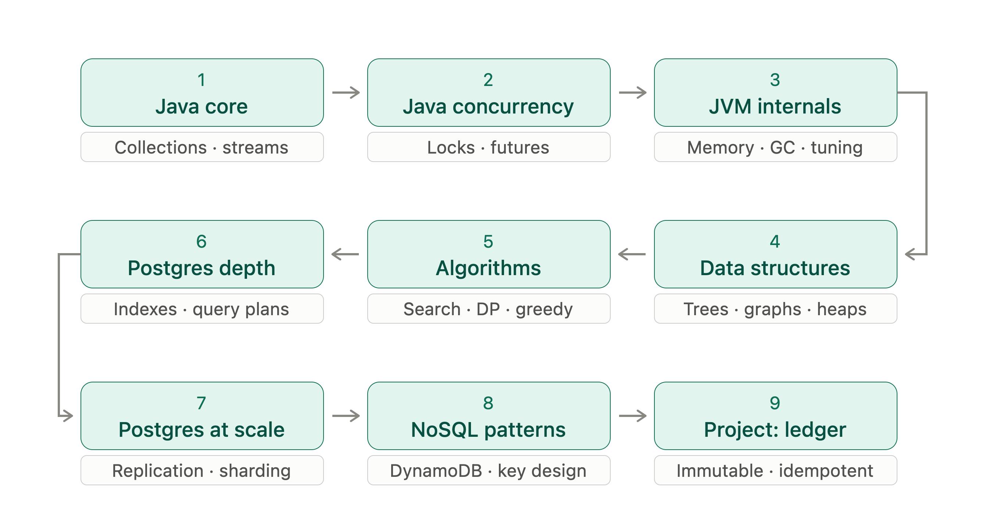
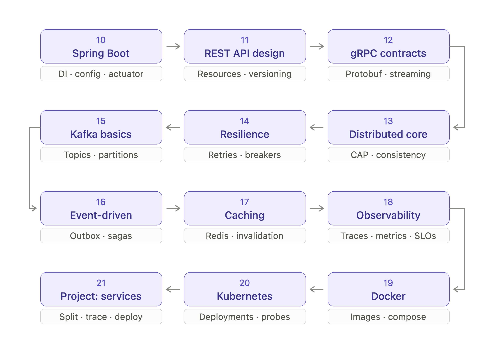
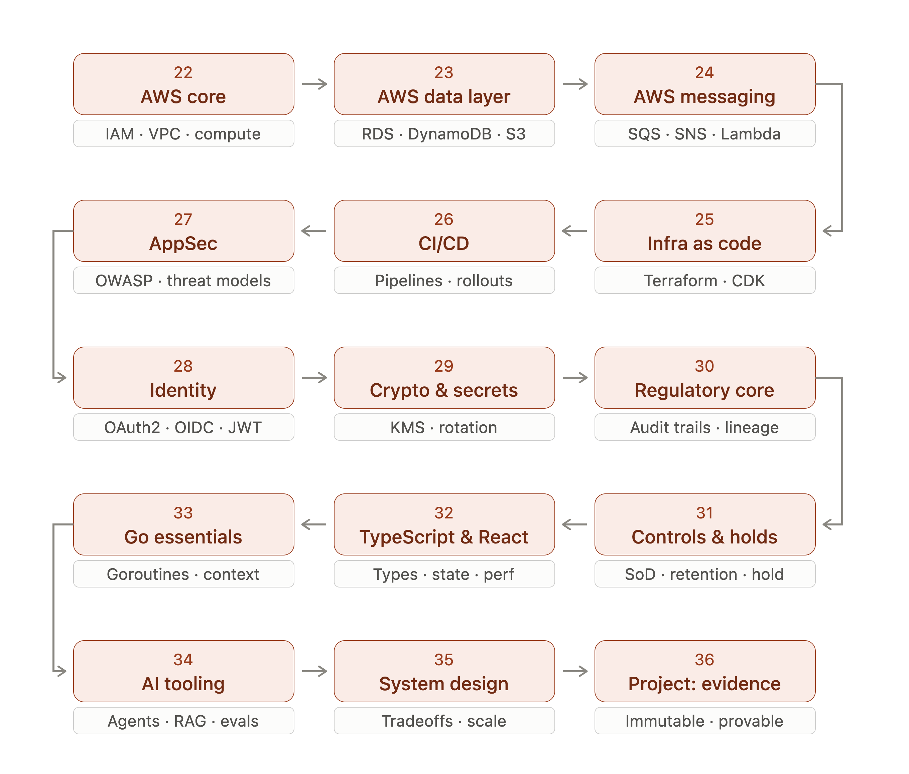

# Course Material

A self-paced engineering roadmap from Java foundations to distributed systems, cloud infrastructure, and regulatory-grade security. **36 nodes across 3 levels**, each ending in a hands-on capstone project.

This repo holds the study notes, resources, and exercises for every node. The code lives in a dedicated `*-course` repository for each subject.

**Status:** ⬜ Not started · 🟨 In progress · ✅ Done

## Level 1 · Foundations

| # | Node | Topics | Code | Status |
|---|---|---|---|---|
| 01 | [Java Core](java/01-java-core.md) | Collections · Streams | [java-course](https://github.com/daltonwilt/java-course) | ⬜ |
| 02 | [Java Concurrency](java/02-java-concurrency.md) | Locks · Futures | [java-course](https://github.com/daltonwilt/java-course) | ⬜ |
| 03 | [JVM Internals](java/03-jvm-internals.md) | Memory · GC · Tuning | [java-course](https://github.com/daltonwilt/java-course) | ⬜ |
| 04 | [Data Structures](dsa/04-data-structures.md) | Trees · Graphs · Heaps | [dsa-course](https://github.com/daltonwilt/dsa-course) | ⬜ |
| 05 | [Algorithms](dsa/05-algorithms.md) | Search · DP · Greedy | [dsa-course](https://github.com/daltonwilt/dsa-course) | ⬜ |
| 06 | [Postgres Depth](databases/06-postgres-depth.md) | Indexes · Query Plans | [databases-course](https://github.com/daltonwilt/databases-course) | ⬜ |
| 07 | [Postgres at Scale](databases/07-postgres-at-scale.md) | Replication · Sharding | [databases-course](https://github.com/daltonwilt/databases-course) | ⬜ |
| 08 | [NoSQL Patterns](databases/08-nosql-patterns.md) | DynamoDB · Key Design | [databases-course](https://github.com/daltonwilt/databases-course) | ⬜ |
| 09 | [Project: Ledger](projects/09-ledger.md) | Immutable · Idempotent | [immutable-ledger](https://github.com/daltonwilt/immutable-ledger) | ⬜ |

## Level 2 · Distributed Systems

| # | Node | Topics | Code | Status |
|---|---|---|---|---|
| 10 | [Spring Boot](spring-boot/10-spring-boot.md) | DI · Config · Actuator | [spring-boot-course](https://github.com/daltonwilt/spring-boot-course) | ⬜ |
| 11 | [REST API Design](spring-boot/11-rest-api-design.md) | Resources · Versioning | [spring-boot-course](https://github.com/daltonwilt/spring-boot-course) | ⬜ |
| 12 | [gRPC Contracts](spring-boot/12-grpc-contracts.md) | Protobuf · Streaming | [spring-boot-course](https://github.com/daltonwilt/spring-boot-course) | ⬜ |
| 13 | [Distributed Core](distributed-systems/13-distributed-core.md) | CAP · Consistency | [distributed-systems-course](https://github.com/daltonwilt/distributed-systems-course) | ⬜ |
| 14 | [Resilience](distributed-systems/14-resilience.md) | Retries · Breakers | [distributed-systems-course](https://github.com/daltonwilt/distributed-systems-course) | ⬜ |
| 15 | [Kafka Basics](distributed-systems/15-kafka-basics.md) | Topics · Partitions | [distributed-systems-course](https://github.com/daltonwilt/distributed-systems-course) | ⬜ |
| 16 | [Event-Driven](distributed-systems/16-event-driven.md) | Outbox · Sagas | [distributed-systems-course](https://github.com/daltonwilt/distributed-systems-course) | ⬜ |
| 17 | [Caching](distributed-systems/17-caching.md) | Redis · Invalidation | [distributed-systems-course](https://github.com/daltonwilt/distributed-systems-course) | ⬜ |
| 18 | [Observability](devops/18-observability.md) | Traces · Metrics · SLOs | [devops-course](https://github.com/daltonwilt/devops-course) | ⬜ |
| 19 | [Docker](devops/19-docker.md) | Images · Compose | [devops-course](https://github.com/daltonwilt/devops-course) | ⬜ |
| 20 | [Kubernetes](devops/20-kubernetes.md) | Deployments · Probes | [devops-course](https://github.com/daltonwilt/devops-course) | ⬜ |
| 21 | [Project: Services](projects/21-services.md) | Split · Trace · Deploy | [services-platform](https://github.com/daltonwilt/services-platform) | ⬜ |

## Level 3 · Cloud, Security & Regulatory

| # | Node | Topics | Code | Status |
|---|---|---|---|---|
| 22 | [AWS Core](aws/22-aws-core.md) | IAM · VPC · Compute | [aws-course](https://github.com/daltonwilt/aws-course) | ⬜ |
| 23 | [AWS Data Layer](aws/23-aws-data-layer.md) | RDS · DynamoDB · S3 | [aws-course](https://github.com/daltonwilt/aws-course) | ⬜ |
| 24 | [AWS Messaging](aws/24-aws-messaging.md) | SQS · SNS · Lambda | [aws-course](https://github.com/daltonwilt/aws-course) | ⬜ |
| 25 | [Infra as Code](devops/25-infra-as-code.md) | Terraform · CDK | [devops-course](https://github.com/daltonwilt/devops-course) | ⬜ |
| 26 | [CI/CD](devops/26-ci-cd.md) | Pipelines · Rollouts | [devops-course](https://github.com/daltonwilt/devops-course) | ⬜ |
| 27 | [AppSec](security/27-appsec.md) | OWASP · Threat Models | [security-course](https://github.com/daltonwilt/security-course) | ⬜ |
| 28 | [Identity](security/28-identity.md) | OAuth2 · OIDC · JWT | [security-course](https://github.com/daltonwilt/security-course) | ⬜ |
| 29 | [Crypto & Secrets](security/29-crypto-and-secrets.md) | KMS · Rotation | [security-course](https://github.com/daltonwilt/security-course) | ⬜ |
| 30 | [Regulatory Core](security/30-regulatory-core.md) | Audit Trails · Lineage | [security-course](https://github.com/daltonwilt/security-course) | ⬜ |
| 31 | [Controls & Holds](security/31-controls-and-holds.md) | SoD · Retention · Hold | [security-course](https://github.com/daltonwilt/security-course) | ⬜ |
| 32 | [TypeScript & React](frontend/32-typescript-and-react.md) | Types · State · Perf | [frontend-course](https://github.com/daltonwilt/frontend-course) | ⬜ |
| 33 | [Go Essentials](go/33-go-essentials.md) | Goroutines · Context | [go-course](https://github.com/daltonwilt/go-course) | ⬜ |
| 34 | [AI Tooling](ai-tooling/34-ai-tooling.md) | Agents · RAG · Evals | [ai-tooling-course](https://github.com/daltonwilt/ai-tooling-course) | ⬜ |
| 35 | [System Design](distributed-systems/35-system-design.md) | Tradeoffs · Scale | [distributed-systems-course](https://github.com/daltonwilt/distributed-systems-course) | ⬜ |
| 36 | [Project: Evidence](projects/36-evidence.md) | Immutable · Provable | [evidence-platform](https://github.com/daltonwilt/evidence-platform) | ⬜ |

## Subjects
- [Java](java/README.md) · [java-course](https://github.com/daltonwilt/java-course)
- [Data Structures & Algorithms](dsa/README.md) · [dsa-course](https://github.com/daltonwilt/dsa-course)
- [Databases](databases/README.md) · [databases-course](https://github.com/daltonwilt/databases-course)
- [Spring Boot](spring-boot/README.md) · [spring-boot-course](https://github.com/daltonwilt/spring-boot-course)
- [Distributed Systems](distributed-systems/README.md) · [distributed-systems-course](https://github.com/daltonwilt/distributed-systems-course)
- [DevOps](devops/README.md) · [devops-course](https://github.com/daltonwilt/devops-course)
- [AWS](aws/README.md) · [aws-course](https://github.com/daltonwilt/aws-course)
- [Security & Compliance](security/README.md) · [security-course](https://github.com/daltonwilt/security-course)
- [Frontend](frontend/README.md) · [frontend-course](https://github.com/daltonwilt/frontend-course)
- [Go](go/README.md) · [go-course](https://github.com/daltonwilt/go-course)
- [AI Tooling](ai-tooling/README.md) · [ai-tooling-course](https://github.com/daltonwilt/ai-tooling-course)
- [Projects](projects/README.md)

## License
[MIT](LICENSE)
